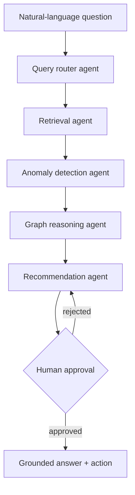
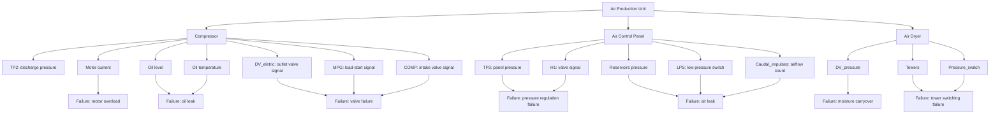

# FaultLens — Component Health Intelligence Agent

A multi-agent, graph-reasoning diagnostic system for industrial equipment monitoring. Ask a plain-English question about equipment sensor data, and the system routes the query, detects anomalies, traces them through a component hierarchy graph to identify the likely failing subsystem, and drafts a maintenance recommendation for human approval.

## The problem

Industrial equipment produces huge volumes of sensor data. When something drifts, an engineer has to notice it, figure out which subsystem it implicates, judge severity, and decide what to do — today that's manual, or at best a flat alert ("sensor X is out of range") that doesn't answer what actually matters: what's failing, how bad is it, and what should happen next.

## The dataset

**MetroPT** — real sensor data from the Air Production Unit (APU) of an operational metro train in Porto, Portugal. Not simulated. ~1.5M readings, Feb–Sep 2020, 15 sensors.

| Sensor | Measures | Subsystem |
|---|---|---|
| TP2 | Compressor discharge pressure (bar) | Compressor |
| Motor_current | Motor current draw (A) | Compressor |
| Oil_temperature | Compressor oil temperature (°C) | Compressor |
| Oil_level | Compressor oil level | Compressor |
| COMP | Air intake valve electrical signal | Compressor |
| DV_eletric | Compressor outlet valve electrical signal | Compressor |
| MPG | Compressor-under-load start signal | Compressor |
| TP3 | Air control panel pressure (bar) | Air Control Panel |
| H1 | Valve activation signal | Air Control Panel |
| Reservoirs | Air tank pressure (bar) | Air Control Panel |
| LPS | Low pressure switch signal | Air Control Panel |
| Caudal_impulses | Airflow pulse count (APU → reservoirs) | Air Control Panel |
| DV_pressure | Pressure drop during air-dryer tower discharge (bar) | Air Dryer |
| Towers | Active drying tower indicator | Air Dryer |
| Pressure_switch | Air dryer pressure switch signal | Air Dryer |

Ground truth comes from the dataset's own documented failure reports: 4 real logged air-leak events with start/end timestamps (4/18, 5/29–5/30, 6/5–6/7, 7/15/2020), each followed by scheduled maintenance.

## Architecture

- **Router** — parses the question, identifies the relevant time window/subsystem keywords.
- **Retrieval** — pulls the relevant sensor slice.
- **Anomaly detection** — rolling z-score per sensor, window tuned to the compressor's measured ~20-minute duty cycle.
- **Graph reasoning** — traces flagged sensors to a subsystem and likely failure type via the component graph.
- **Recommendation** — drafts a maintenance action; nothing is final without human approval.

## Component graph

## Evaluation

- 15-20 labeled diagnostic test cases, built from the dataset's real documented failures plus negative controls.
- **Diagnosis accuracy** — correct module/failure type vs. ground truth.
- **Retrieval precision** — correct sensor/time window pulled for the question.
- **Baseline comparison** — same test set run through a naive single-shot LLM (no graph, no tools), gap reported as evidence the structured pipeline does real work.

## Team split

- **Hamza** — component graph, anomaly detection agent, diagnosis agent, evaluation harness.
- **Eya** — LangGraph orchestration, retrieval and recommendation agents, demo interface.

## Known limitations

- Anomaly severity naturally decays during long, sustained faults, since the rolling baseline gradually adapts to the ongoing abnormal readings. A two-pass baseline-freezing fix was attempted but introduced a division-by-near-zero issue on low-variance sensors; a more robust fix (per-sensor-scaled epsilon, or explicit handling of frozen baselines) is a natural v2 extension.
- Subsystem localization in `diagnose()` is unreliable for leak-type failures. The heuristic picks the subsystem whose earliest flagged sensor fired first, on the assumption that the root cause shows symptoms before the rest of the system reacts. In practice, air leaks cause system-wide stress almost immediately — 9 to 13 of the 15 sensors flag within the same event — so there's little localized signal to find. Validated against all 4 of MetroPT-3's documented air-leak events, the heuristic correctly identified the subsystem/failure type in 1 of 4. The remaining failure modes in the signature table (oil leak, motor overload, valve failure) have no documented ground-truth events in this dataset at all and are unverified domain-knowledge guesses, not empirically validated mappings.
- Sensor-to-module mapping is grounded in the dataset's own documentation, but severity thresholds required some judgment calls, documented in code comments.
- The eval set is modest (15-20 cases) given how few real documented failures exist in the data — a deliberate, stated tradeoff, not a large-scale benchmark.

## Framing

This is a multi-agent diagnostic reasoning system — the architecture is the point, MetroPT is just the evidence base it's validated against.